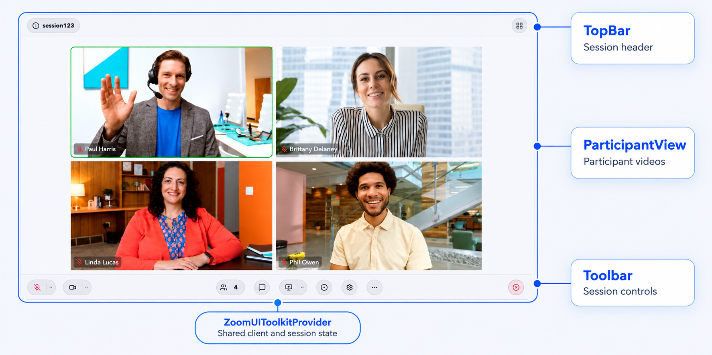

# Video SDK UI Toolkit Modular for React

Build real-time video sessions with the [Zoom Video SDK](https://developers.zoom.us/docs/video-sdk/web/) in React 19. Choose between a complete prebuilt session screen or compose your own layout from individual modules, buttons, panels, and hooks.



> The screenshot shows App mode on desktop. The labeled regions — `TopBar`, `ParticipantView`, and `Toolbar` — are available individually in Component mode.

Use of this SDK is subject to our [Terms of Use](https://www.zoom.com/en/trust/video-sdk-terms/).

## Contents

- [Overview](#overview)
- [Prerequisites](#prerequisites)
- [Installation](#installation)
- [Quickstart](#quickstart)
- [AI coding skills](#ai-coding-skills)
- [App mode vs Component mode](#app-mode-vs-component-mode)
- [App mode highlights](#app-mode-highlights)
- [Component mode highlights](#component-mode-highlights)
- [Platform setup](#platform-setup)
- [Resources and links](#resources-and-links)

---

## Overview

| Mode               | What it gives you                                                    |
| ------------------ | -------------------------------------------------------------------- |
| **App mode**       | Complete session screen in a single `<ZoomUIToolkitApp />` component |
| **Component mode** | 7 modules and 20+ components and hooks for custom layouts            |

Both modes support dark and light themes and automatic mobile layouts.

---

## Prerequisites

- Node.js 20.12+
- React 19 (Next.js, or any React 19 setup)
- Zoom Video SDK credentials from the [Zoom App Marketplace](https://marketplace.zoom.us/)
- An auth server to issue session tokens

---

## Installation

```bash
npm install @zoom/videosdk-ui-toolkit@2.6.0-2 @zoom/videosdk react@19 react-dom@19
```

Then import the stylesheet once at your app entry point:

```ts
import '@zoom/videosdk-ui-toolkit/style.css';
```

### Peer dependencies

| Package          | Minimum version |
| ---------------- | --------------- |
| `@zoom/videosdk` | 2.6.0           |
| `react`          | 19.0.0          |
| `react-dom`      | 19.0.0          |

---

## Quickstart

Build a minimal working session in four steps.

### Step 1 — Start the auth server

Clone and run the auth endpoint sample:

```bash
git clone https://github.com/zoom/videosdk-auth-endpoint-sample.git
cd videosdk-auth-endpoint-sample
cp .env.example .env
npm install
```

Set `ZOOM_VIDEO_SDK_KEY` and `ZOOM_VIDEO_SDK_SECRET` in `.env`, then start:

```bash
npm run start
```

### Step 2 — Create a React 19 app

```bash
npm create vite@latest video-session -- --template react-ts
cd video-session
npm install
npm install @zoom/videosdk-ui-toolkit@2.6.0-2 @zoom/videosdk react@19 react-dom@19
```

### Step 3 — Add the app files

Add these files to `src/`. Set your `topic`, `userName`, and `role` in `config.ts`:

| File           | Purpose                                             |
| -------------- | --------------------------------------------------- |
| `main.tsx`     | Imports the stylesheet and mounts the app           |
| `config.ts`    | Session config                                      |
| `auth.ts`      | Fetches a token from the auth server                |
| `App.tsx`      | Creates the SDK client and wraps it in the provider |
| `Viewport.tsx` | Join button and session UI                          |

See the [full React sample](https://github.com/zoom/videosdk-ui-toolkit-modular-sample) for complete file contents.

### Step 4 — Run and join

```bash
npm run dev
```

Open the localhost URL, click **Join session**, then select **Audio** and **Video**. For a second participant, open another browser with the same `topic`, a different `userName`, and `role` set to `0` or `1`.

### Try the full React sample

The official React sample includes both modes with live controls:

```bash
git clone https://github.com/zoom/videosdk-ui-toolkit-modular-sample.git
cd videosdk-ui-toolkit-modular-sample
npm install
npm run dev
```

---

## AI coding skills

The package ships an agent skill, `uitoolkit-integration`. It teaches AI coding tools how to use the toolkit correctly: installation, provider setup, App and Component modes, theming, and the session lifecycle. It also includes a machine-readable API contract (JSON) for every component, module, and hook.

### Install the skill

Run this from your project root after installing the package:

```bash
npx uitoolkit-skill-setup
```

With no options, the skill is installed for every supported tool. Pass one or more options to install it only for specific tools:

| Option     | Tool        | Installs to       |
| ---------- | ----------- | ----------------- |
| `--claude` | Claude Code | `.claude/skills/` |
| `--cursor` | Cursor      | `.cursor/skills/` |
| `--codex`  | Codex       | `.agents/skills/` |

```bash
npx uitoolkit-skill-setup --claude --cursor
```

Restart your AI tool afterwards to load the skill. Re-run the command after upgrading the package, so the skill matches the installed version (existing copies are replaced).

### What's included

| Path          | Contents                                                                                    |
| ------------- | ------------------------------------------------------------------------------------------- |
| `SKILL.md`    | Entry point: architecture layers, theming, joining a session, and an index of guides        |
| `app.md`      | `ZoomUIToolkitApp`, `ZoomUIToolkitProvider`, `ZoomUIToolkitRoot`, and the session lifecycle |
| `modules/`    | One guide per module (`Toolbar`, `TopBar`, `ParticipantView`, …)                            |
| `components/` | One guide per button, panel, and video primitive                                            |
| `api/`        | JSON API contracts indexed by `api/manifest.json`                                           |

You can also browse the skill directly in `skills/uitoolkit-integration/` or in `node_modules/@zoom/videosdk-ui-toolkit/skills/`.

---

## App mode vs Component mode

| Choose             | When to use it                                                                        | What you render                                              |
| ------------------ | ------------------------------------------------------------------------------------- | ------------------------------------------------------------ |
| **App mode**       | You want a complete session screen with built-in layout and responsive behavior.      | `<ZoomUIToolkitApp />` inside `<ZoomUIToolkitProvider>`      |
| **Component mode** | You need custom placement, a minimal set of controls, or your own session experience. | Modules, buttons, panels, and hooks inside the same provider |

---

## App mode highlights

`ZoomUIToolkitApp` renders the complete session experience. Pair it with `JoinButton` or your own `client.join()`.

### Features

- **Gallery / Speaker view** with a paginated grid or a large tile
- **Screen share** with a banner and View Options
- **Chat** with messages to everyone or one person
- **Participants** with search and role-based actions
- **Settings** with Audio, Video, Share, and Statistics tabs
- **Notifications** for media issues, network, and recording consent
- **Responsive toolbar** that overflows into a More button
- **Automatic mobile layouts** — swipeable pages and bottom sheets

### Key configuration props

| To change                                 | Use                                                                                    |
| ----------------------------------------- | -------------------------------------------------------------------------------------- |
| Size and container styling                | `width`, `height` (both default `'100%'`), `className`, `style`                        |
| Which toolbar buttons appear              | `toolbarProps.visibleButtons`                                                          |
| Extra audio/video menu items              | `toolbarProps.audioButtonProps.menuGroups`, `toolbarProps.videoButtonProps.menuGroups` |
| Chat bubble colors                        | `toolbarProps.chatButtonProps.messageBubbleStyles`                                     |
| Theme                                     | Provider `theme='dark' \| 'light'`                                                     |
| Noise suppression and virtual backgrounds | Provider `sessionOptions.audio` and `sessionOptions.video`                             |
| Stacking order relative to your page      | Provider `baseZIndex` (default `1000`)                                                 |
| Microphone / speaker test in Settings     | Provider `localAudioTrack`                                                             |

For custom placement or minimal controls, use Component mode.

---

## Component mode highlights

All components render inside `ZoomUIToolkitProvider` and share one session state.

### API layers

| Layer                | What you get                                                                                                                                                                 |
| -------------------- | ---------------------------------------------------------------------------------------------------------------------------------------------------------------------------- |
| **Modules**          | `Toolbar`, `TopBar`, `ParticipantView`, `MobileParticipantView`, `ActiveSpeakerView`, `ShareViewerView`, `SharePresenterView`                                                |
| **Buttons**          | `JoinButton`, `LeaveButton`, `AudioButton`, `VideoButton`, `ShareButton`, `RecordButton`, `ParticipantButton`, `ChatButton`, `SettingsButton`, `MoreButton`, `ToolbarButton` |
| **Panels**           | `ParticipantPanel`, `SettingsPanel`, `SessionInfoPanel`, `ReclaimHostBanner`                                                                                                 |
| **Video primitives** | `VideoLayout`, `MobileVideoLayout`, `ParticipantTile`, `ShareViewLayout`, `ShareTile`                                                                                        |
| **Hooks**            | `useZoomUIToolkit`, `useAudioController`, `useVideoController`, `useShareController`, `useRecordingController`, `useTheme`                                                   |

### Example layouts

#### Standard video layout

```tsx
// src/MeetingLayout.tsx
import { ParticipantView, ShareViewerView, Toolbar, TopBar, useZoomUIToolkit } from '@zoom/videosdk-ui-toolkit';

export function MeetingLayout() {
  const { shareState } = useZoomUIToolkit();

  return (
    <div style={{ display: 'grid', gridTemplateRows: 'auto minmax(0, 1fr) auto', height: '100dvh' }}>
      <TopBar />
      <div style={{ position: 'relative', minHeight: 0 }}>
        <ParticipantView pageSize={9} hidden={shareState.isReceivingShare} />
        <ShareViewerView hidden={!shareState.isReceivingShare} />
      </div>
      <Toolbar />
    </div>
  );
}
```

#### Custom controls with hooks

```tsx
import { ConnectionState, useAudioController, useVideoController, useZoomUIToolkit } from '@zoom/videosdk-ui-toolkit';

export function CustomControls() {
  const { sessionState } = useZoomUIToolkit();
  const audio = useAudioController();
  const video = useVideoController();
  const connected = sessionState.connectionState === ConnectionState.Connected;

  return (
    <div>
      <button disabled={!connected || !audio.canControlAudio} onClick={() => void audio.toggleAudio()}>
        {!audio.audioState.isJoined ? 'Join audio' : audio.audioState.isMuted ? 'Unmute' : 'Mute'}
      </button>
      <button disabled={!connected || !video.canControlVideo} onClick={() => void video.toggleVideo()}>
        {video.videoState.isVideoOn ? 'Stop video' : 'Start video'}
      </button>
    </div>
  );
}
```

### Theming

Pass the `theme` prop to `ZoomUIToolkitProvider`. The accepted values are `'dark'` (default) and `'light'`:

```tsx
<ZoomUIToolkitProvider clientInstance={client} theme='light'>
  <YourVideoApp />
</ZoomUIToolkitProvider>
```

To give part of your layout a different theme, wrap it in `ThemeProvider`. Read the current theme with `useTheme()`.

### Stacking order

The provider's `baseZIndex` (default `1000`) sets the stacking order of `ZoomUIToolkitApp` and `ZoomUIToolkitRoot`. Panels, menus, dialogs, and bottom sheets opened by built-in components use the values just above it. To group your own components in the same stacking context, wrap them in `ZoomUIToolkitRoot`:

```tsx
<ZoomUIToolkitProvider clientInstance={client} baseZIndex={2000}>
  <ZoomUIToolkitRoot>
    <AudioButton />
    <VideoButton />
  </ZoomUIToolkitRoot>
</ZoomUIToolkitProvider>
```

`ZoomUIToolkitApp` already forms this stacking layer, so don't wrap it in `ZoomUIToolkitRoot`.

---

## Platform setup

### Cross-origin isolation

For full media support (720p, virtual backgrounds), enable cross-origin isolation with these headers:

```http
Cross-Origin-Opener-Policy: same-origin
Cross-Origin-Embedder-Policy: require-corp
```

Verify in the browser console:

```js
window.crossOriginIsolated; // true
typeof SharedArrayBuffer; // 'function'
```

> [!NOTE]
> With `require-corp`, verify that third-party resources still load correctly.

### Vite

```ts
// vite.config.ts
import { defineConfig } from 'vite';
import react from '@vitejs/plugin-react';

const headers = {
  'Cross-Origin-Opener-Policy': 'same-origin',
  'Cross-Origin-Embedder-Policy': 'require-corp',
};

export default defineConfig({
  plugins: [react()],
  server: { headers },
  preview: { headers },
});
```

### Next.js

Add the headers in `next.config.js`:

```js
// next.config.js
module.exports = {
  async headers() {
    return [
      {
        source: '/:path*',
        headers: [
          { key: 'Cross-Origin-Opener-Policy', value: 'same-origin' },
          { key: 'Cross-Origin-Embedder-Policy', value: 'require-corp' },
        ],
      },
    ];
  },
};
```

Load the session screen with `next/dynamic` and `ssr: false`:

```tsx
// app/session/page.tsx
'use client';

import dynamic from 'next/dynamic';

const App = dynamic(() => import('../../components/App').then((mod) => mod.App), {
  ssr: false,
  loading: () => <p>Loading the video session…</p>,
});

export default function SessionPage() {
  return <App />;
}
```

---

## Resources and links

- [Zoom Video SDK for Web — Developer Docs](https://developers.zoom.us/docs/video-sdk/web/)
- [Full React sample](https://github.com/zoom/videosdk-ui-toolkit-modular-sample) — App mode and Component mode playground
- [Video SDK auth endpoint sample](https://github.com/zoom/videosdk-auth-endpoint-sample)
- [Video SDK browser support matrix](https://developers.zoom.us/docs/video-sdk/web/browser-support/)
- [Developer Support](https://developers.zoom.us/support/)
- [Developer Forum](https://devforum.zoom.us)
- [Premier Developer Support](https://explore.zoom.us/docs/en-us/developer-support-plans.html) — priority support plans
